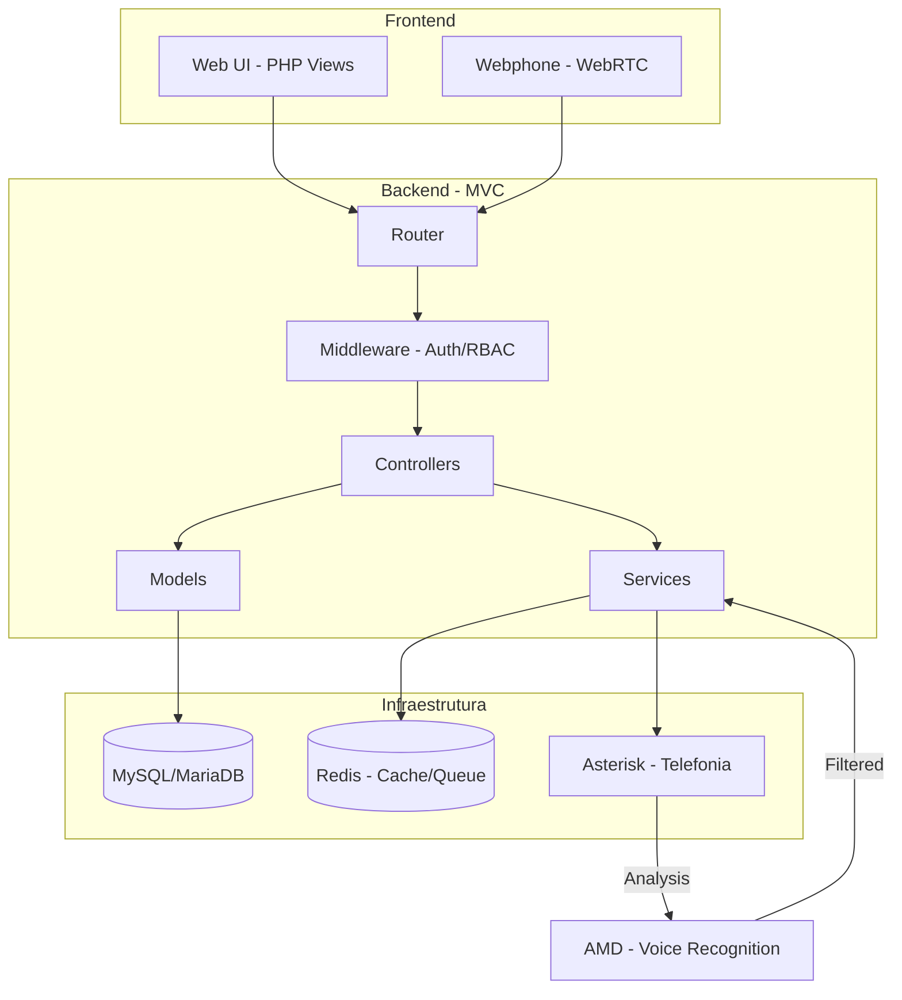
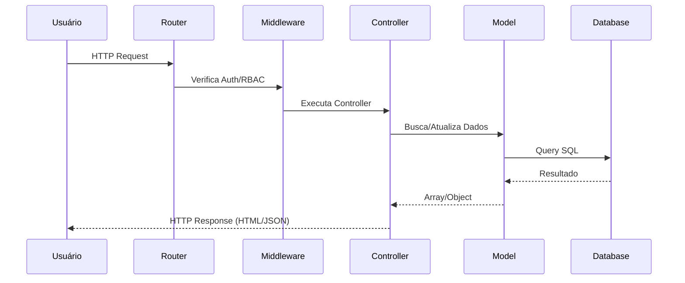

# Arquitetura do Sistema - Diamond Dialer

> Sistema de Discador Automático para Call Centers

---

## Visão Geral

O **Diamond Dialer** é uma plataforma web completa para operações de Call Center que gerencia todo o ciclo de vida de campanhas de discagem. O sistema utiliza arquitetura MVC (Model-View-Controller) com PHP 8.2+.

---

## Stack Tecnológico

| Componente | Tecnologia | Versão Mínima |
|-----------|------------|---------------|
| **Backend** | PHP | 8.2+ |
| **Banco de Dados** | MySQL / MariaDB | 8.0+ / 10.6+ |
| **Cache/Queue** | Redis | 7.0+ |
| **Telefonia** | Asterisk | 18+ |

---

## Estrutura de Diretórios

```
discador/
├── app/                    # Código da aplicação
│   ├── Controllers/        # 15 controladores MVC
│   ├── Core/               # 7 classes fundamentais (Router, Database, Session, View...)
│   ├── Middleware/         # Auth, RBAC
│   ├── Models/             # 6 modelos de dados
│   ├── Repositories/       # Repositórios de dados
│   └── Services/           # 4 serviços de negócio
│
├── config/                 # Configurações
│   ├── app.php            # Configurações da aplicação
│   ├── database.php       # Configurações de banco de dados
│   └── routes.php         # Definição de rotas HTTP (242 linhas)
│
├── database/               # Migrations e Seeds
│   ├── migrations/        # 24 migrations
│   ├── seeds/             # Seeds de dados iniciais
│   └── migrate.php        # Script de migração
│
├── public/                 # Entry point e assets públicos
├── resources/views/        # 13 módulos de views (41 arquivos)
├── services/               # Serviços externos (dialer, websocket, telephony)
├── storage/                # Logs, uploads, cache
├── tests/                  # Testes automatizados
└── vendor/                 # Dependências (Composer)
```

---

## Diagrama de Arquitetura



---

## Fluxo de Dados



---

## Padrões Arquiteturais

### MVC (Model-View-Controller)
- **Models**: Encapsulam lógica de dados e queries SQL
- **Views**: Templates PHP em `resources/views/`
- **Controllers**: Processam requests e retornam responses

### Multi-Tenant
- Isolamento de dados por `tenant_id`
- Configurável via `app.php` (`multi_tenant => true`)

### RBAC (Role-Based Access Control)
| Role | Permissões |
|------|-----------|
| **admin** | Acesso total a todos os módulos |
| **supervisor** | Gestão de campanhas, agentes e relatórios da equipe |
| **agent** | Interface de atendimento apenas |

---

## Core Classes

| Classe | Responsabilidade |
|--------|-----------------|
| [Router.php](file:///c:/xampp/htdocs/discador/app/Core/Router.php) | Roteamento HTTP, grupos, middlewares |
| [Database.php](file:///c:/xampp/htdocs/discador/app/Core/Database.php) | Conexão PDO, queries, multi-tenant |
| [Session.php](file:///c:/xampp/htdocs/discador/app/Core/Session.php) | Gerenciamento de sessões |
| [View.php](file:///c:/xampp/htdocs/discador/app/Core/View.php) | Renderização de templates |
| [Controller.php](file:///c:/xampp/htdocs/discador/app/Core/Controller.php) | Classe base para controllers |
| [Queue.php](file:///c:/xampp/htdocs/discador/app/Core/Queue.php) | Filas de jobs assíncronos |
| [RedisClient.php](file:///c:/xampp/htdocs/discador/app/Core/RedisClient.php) | Cliente Redis |

---

## Limites do Sistema

```php
'limits' => [
    'max_agents' => 150,
    'max_campaigns_per_tenant' => 50,
    'max_upload_size' => 20 * 1024 * 1024, // 20MB
    'session_lifetime' => 120, // minutos
]
```

---

## Requisitos Não-Funcionais

1. **Desempenho**: Múltiplas campanhas simultâneas com alta volumetria
2. **Latência**: Comunicação WebRTC < 200ms
3. **Escalabilidade**: Arquitetura horizontal
4. **Auditoria central**: Logs de ações críticas disponíveis exclusivamente ao super admin, com filtro por empresa
5. **AMD**: Reconhecimento de voz em < 3 segundos para detecção de caixa postal
6. **Backup**: Estratégias para bases de contatos e histórico

---

## Links Importantes

- [README.md](file:///c:/xampp/htdocs/discador/README.md) - Instalação e Quick Start
- [REQUISITOS_SISTEMA.md](file:///c:/xampp/htdocs/discador/docs/REQUISITOS_SISTEMA.md) - Especificação de Requisitos
- [API.md](file:///c:/xampp/htdocs/discador/docs/API.md) - Documentação de Rotas e Endpoints
- [MODELS.md](file:///c:/xampp/htdocs/discador/docs/MODELS.md) - Documentação de Models
- [DATABASE.md](file:///c:/xampp/htdocs/discador/docs/DATABASE.md) - Schema do Banco de Dados
---

## Autenticacao

O e-mail e a identidade global e exclusiva de acesso ao painel compartilhado. Ramais sao identificadores de telefonia e nao autenticam usuarios. As regras de normalizacao, unicidade, recuperacao de senha e migracao segura estao documentadas em [AUTENTICACAO_E_IDENTIDADE.md](AUTENTICACAO_E_IDENTIDADE.md).
# Capacidade operacional

Os limites tecnicos, filas dedicadas, armazenamento de gravacoes, arquivamento e roteiro de homologacao estao documentados em [CAPACIDADE_E_HOMOLOGACAO.md](CAPACIDADE_E_HOMOLOGACAO.md).
