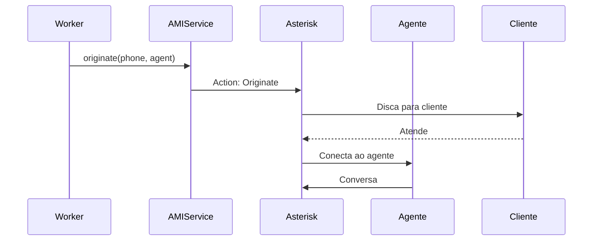
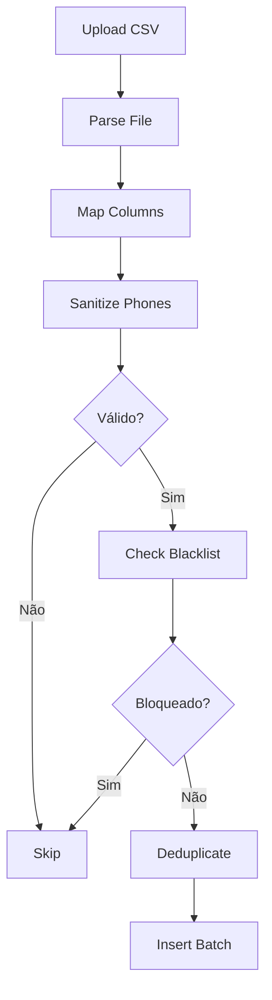

# Documentação de Services - Diamond Dialer

> Referência dos serviços de negócio

---

## Visão Geral

O sistema possui **4 services** que encapsulam lógica de negócio complexa:

| Service | Responsabilidade |
|---------|-----------------|
| [AMIService](#amiservice) | Comunicação com Asterisk via AMI |
| [ImportProcessor](#importprocessor) | Processamento de importações |
| [WebSocketService](#websocketservice) | Comunicação em tempo real |
| [WebhookService](#webhookservice) | Disparo de webhooks |

---

## AMIService

**Arquivo**: [app/Services/AMIService.php](file:///c:/xampp/htdocs/discador/app/Services/AMIService.php)

### Responsabilidade

Gerencia a comunicação com o Asterisk Manager Interface (AMI) para controle de telefonia.

### Funcionalidades

| Método | Descrição |
|--------|-----------|
| `originate()` | Origina uma chamada do sistema |
| `hangup()` | Encerra uma chamada |
| `redirect()` | Transfere chamada |
| `spy()` | Escuta uma chamada (supervisão) |
| `whisper()` | Sussurra ao agente |
| `barge()` | Entra na conferência |

### Configuração

```php
// .env
AMI_HOST=127.0.0.1
AMI_PORT=5038
AMI_USER=admin
AMI_SECRET=secret
```

### Fluxo de Discagem



---

## ImportProcessor

**Arquivo**: [app/Services/ImportProcessor.php](file:///c:/xampp/htdocs/discador/app/Services/ImportProcessor.php)

### Responsabilidade

Processa arquivos CSV/TXT de importação de contatos com validação e sanitização.

### Funcionalidades

| Método | Descrição |
|--------|-----------|
| `process()` | Processa arquivo completo |
| `parseFile()` | Lê e parseia CSV/TXT |
| `mapColumns()` | Aplica mapeamento de colunas |
| `sanitizePhone()` | Limpa e valida telefones |
| `deduplicate()` | Remove duplicados |
| `insertBatch()` | Insere em lotes |

### Regras de Sanitização

| Regra | Exemplo |
|-------|---------|
| Remove caracteres não numéricos | `(11) 9999-9999` → `11999999999` |
| Adiciona código de país | `11999999999` → `5511999999999` |
| Valida formato | Mínimo 10 dígitos |

### Fluxo de Processamento



---

## WebSocketService

**Arquivo**: [app/Services/WebSocketService.php](file:///c:/xampp/htdocs/discador/app/Services/WebSocketService.php)

### Responsabilidade

Gerencia comunicação em tempo real via WebSocket para atualização de status.

### Funcionalidades

| Método | Descrição |
|--------|-----------|
| `broadcast()` | Envia para todos os clientes |
| `send()` | Envia para cliente específico |
| `subscribe()` | Assina um canal |
| `unsubscribe()` | Cancela assinatura |

### Eventos Enviados

| Evento | Dados | Destinatário |
|--------|-------|-------------|
| `agent:status` | `{agent_id, status}` | Dashboard/Supervisor |
| `call:started` | `{call_id, contact}` | Agente |
| `call:ended` | `{call_id, disposition}` | Dashboard |
| `campaign:stats` | `{campaign_id, stats}` | Supervisor |

### Integração com Redis

```php
// Publica evento
$redis->publish('channel', json_encode($event));

// Fallback: API polling se WebSocket não disponível
GET /api/agent/status
```

---

## WebhookService

**Arquivo**: [app/Services/WebhookService.php](file:///c:/xampp/htdocs/discador/app/Services/WebhookService.php)

### Responsabilidade

Dispara notificações HTTP para sistemas externos (CRM, etc) quando eventos ocorrem.

### Funcionalidades

| Método | Descrição |
|--------|-----------|
| `dispatch()` | Dispara webhook para evento |
| `send()` | Envia request HTTP |
| `log()` | Registra tentativa |
| `retry()` | Retenta em caso de falha |

### Eventos Suportados

| Evento | Trigger |
|--------|---------|
| `call.started` | Chamada iniciada |
| `call.answered` | Chamada atendida |
| `call.ended` | Chamada encerrada |
| `disposition.saved` | Tabulação salva |
| `sale.completed` | Venda realizada |

### Payload Enviado

```json
{
    "event": "call.ended",
    "timestamp": "2026-01-29T18:00:00Z",
    "data": {
        "call_id": 12345,
        "campaign_id": 1,
        "contact_id": 5678,
        "agent_id": 10,
        "phone": "5511999999999",
        "duration": 180,
        "disposition": "SALE"
    }
}
```

### Segurança

```php
// Headers enviados
Authorization: Bearer {secret}
X-Webhook-Signature: sha256={hash}
Content-Type: application/json
```

### Retry Policy

| Tentativa | Delay |
|-----------|-------|
| 1 | Imediato |
| 2 | 30 segundos |
| 3 | 1 minuto |
| 4 | 5 minutos |
| 5 | Desiste |

---

## Localização dos Services

```
app/
└── Services/
    ├── AMIService.php          # Asterisk Manager Interface
    ├── ImportProcessor.php     # Processamento de importações
    ├── WebSocketService.php    # Comunicação em tempo real
    └── WebhookService.php      # Integrações externas
```

---

## Worker de Background

**Arquivo**: [worker.php](file:///c:/xampp/htdocs/discador/worker.php)

### Responsabilidade

Processa jobs em background como discagem automática e processamento de filas.

### Execução

```bash
php worker.php
```

### Jobs Processados

| Job | Descrição |
|-----|-----------|
| `dialer:next` | Busca próximo contato para discar |
| `import:process` | Processa arquivo de importação |
| `webhook:dispatch` | Dispara webhook |
| `report:generate` | Gera relatório em background |

---

## Dialer Core

**Arquivo**: [dialer.php](file:///c:/xampp/htdocs/discador/dialer.php)

### Responsabilidade

Motor de discagem principal que gerencia a fila de contatos e alocação de chamadas.

### Algoritmos de Discagem

| Modo | Comportamento |
|------|--------------|
| **Power** | Disca X contatos para cada agente disponível |
| **Predictive** | Ajusta agressividade baseado em métricas |
| **Preview** | Mostra contato antes de discar |

### Regra de Prioridade

1. Callbacks agendados (hora exata)
2. Listas com maior peso
3. Contatos virgens (0 tentativas)
4. Rechamadas automáticas
